# Hi, I'm Amil.

[Website](https://amilagrawal.com/) · [Email](mailto:amil_agrawal@brown.edu) · [LinkedIn](https://www.linkedin.com/in/amil-ag)

I study **computer science & math at Brown University**. I'm interested in **reinforcement learning, world models, and efficient inference**.

Across industry and personal projects, I've also worked on robotics, recommender systems, LLM post-training, and large-scale inference infrastructure.

**Internships:** ML research at **Snap** · inference at **AMD** · robotics at **Raytheon** · software at **Bloomfilter**.

At Brown, I lead [Brownie Research](https://brownieresear.ch/), organize [Emergent](https://about.emergentconference.org/), and am part of Brown Space Engineering.

### Selected work

| Project | What I'm building |
| :--- | :--- |
| [**RSGbot**](https://amilagrawal.com/rsgbot/) | A Minecraft speedrunning agent: screenshots in, keyboard and mouse actions out. |
| [**RapidTinyRec**](https://github.com/amilcodes/RapidTinyRec) | Faster MiniOneRec inference with shared KV caches, batched constraints, and native GQA. |
| [**SysVRC**](https://github.com/amilcodes/SysVRC) | Autonomous VRC routines in ROS 2 and Gazebo. |
| [**PAVER**](https://github.com/amilcodes/paver) | Recovering occluded street-view pixels from neighboring panoramas using feature matching and geometry. |

Also: [Reconstructing Mercury](https://github.com/amilcodes/mercury-reconstruction) · [wild-env](https://github.com/amilcodes/wild-env) · [stemp](https://github.com/amilcodes/stemp)

### On GitHub

  <picture>
    <source media="(prefers-color-scheme: dark)" srcset="https://raw.githubusercontent.com/amilcodes/amilcodes/main/profile/stats-dark.svg">
    
  </picture>
  <picture>
    <source media="(prefers-color-scheme: dark)" srcset="https://raw.githubusercontent.com/amilcodes/amilcodes/main/profile/languages-dark.svg">
    
  </picture>

Public repository stats, refreshed daily. Language shares reflect code size.

I love meeting new people — feel free to [say hello](mailto:amil_agrawal@brown.edu)!
